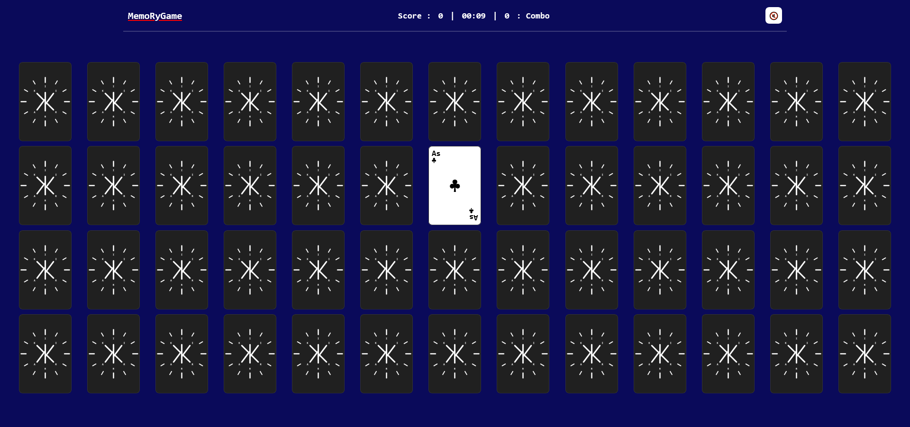

# 🧠 MemoRyGame — V2

Un jeu de mémoire en JavaScript où le joueur doit retrouver des paires de cartes en minimisant son score.

Le projet a évolué d’un prototype de cartes statiques (V1) vers une **architecture modulaire complète (V2)** inspirée des standards de développement de jeux vidéo (**State Machine** & **Data-Driven Design**), intégrant deux modes de difficulté, un chronomètre, un moteur audio extensible et un classement en ligne sécurisé propulsé par **Supabase**.

## 

---

## 🎮 Objectif du jeu

Retrouver toutes les paires de cartes en terminant la partie avec le **score le plus bas possible** et le meilleur temps.

- Le chronomètre démarre automatiquement au premier clic
- Deux cartes sont révélées et comparées à chaque tour
- Si elles correspondent → **match** (elles restent visibles)
- Sinon → elles se retournent après un court délai de mémorisation

---

## 🧩 Règles de jeu & Difficultés

### 🎚️ Modes de jeu

- **Facile (26 cartes) :** Grille 2×13 utilisant uniquement les cartes rouges (Cœur & Carreau)
- **Normal (52 cartes) :** Grille 4×13 utilisant un jeu complet de 52 cartes

### ✔ Match valide

- Même valeur (`2` à `As`)
- Même couleur / famille (`Rouge` / `Noir`)

### ❌ Match invalide

- `+1` point de pénalité
- Remise à zéro du combo

---

## 🔥 Système de score

- ❌ **Erreur** → `+1` point
- ✔ **Match** → le compteur de combo augmente
- 🔥 **Combo ≥ 2** → `-1` point bonus par match consécutif
- 💀 **Combo reset** → retour au calcul normal

👉 **Objectif :** obtenir le score le plus bas possible (le score peut même devenir négatif grâce aux combos !).

---

## 🏆 Classement en ligne & Sécurité

Le jeu intègre un **Top 10 mondial** par mode de difficulté connecté à une base **PostgreSQL (Supabase)**, protégé par une sécurité double couche :

- **Côté Client (`security.js`) :** Protection anti-XSS (filtrage des caractères spéciaux), normalisation _leetspeak_ (`0 → o`, `3 → e`, etc.) et modération via un dictionnaire JSON externe (`mots_interdits.json`) avec gestion des faux positifs.
- **Côté Serveur (Supabase RLS & SQL) :**
  - **Row Level Security (RLS)** activé : accès public (`anon`) limité strictement à la lecture (`SELECT`) et à l'ajout (`INSERT`) — aucune modification ni suppression possible.
  - **Contraintes SQL (`CHECK`) :** Validation stricte côté base de données du format du pseudo (`^[a-zA-Z0-9_-]{3,16}$`), de la plage de score réaliste (`-26` à `999`) et du format du chronomètre (`MM:SS`).

---

## 🔊 Système audio

- Moteur audio Singleton (`sounds.js`) piloté par la configuration centrale
- Déblocage propre de l'`AudioContext` dès la première interaction utilisateur
- Protection anti-spam (_debounce_) sur les clics rapides
- Toggle **ON / OFF** accessible depuis le menu principal
- Architecture prête à accueillir une banque complète d'effets sonores personnalisés

---

## 📁 Structure du projet (V2)

```text
C:.\MemoRyGame
+--- index.html
+--- Assets
|   \--- Sounds
|       \--- flipcard.mp3
+--- Data
|   \--- mots_interdits.json
+--- JavaScript
|   +--- main.js
|   +--- Engine

|   |   +--- config.js
|   |   +--- network.js
|   |   +--- security.js
|   |   \--- sounds.js
|   +--- Entities

|   |   +--- carte.js
|   |   \--- deck.js
|   +--- Logo

|   |   +--- logo_centre.js
|   |   +--- logo_externe.js
|   |   +--- logo_interne.js
|   |   \--- logoEngine.js
|   \--- States
|       +--- creditsState.js
|       +--- gameState.js
|       +--- menuState.js
|       +--- optionsState.js
|       +--- scoresState.js
|       +--- stateManager.js
|       \--- victoryState.js
\--- Style
    +--- main.css
    +--- Entities
    |   \--- carte.css
    +--- Logo
    |   \--- style.css
    \--- States
        +--- credits.css
        +--- game.css
        +--- menu.css
        +--- options.css
        +--- responsive.css
        +--- scores.css
        \--- victory.css
```

---

## 🧠 Architecture logicielle (V2)

### ⚙️ `Engine/` — Cœur technique & Data-Driven Design

- **`config.js`** : Source unique de vérité regroupant les réglages du joueur, les modes de difficulté, les règles de scoring, les timings (_Game Feel_), les paramètres de sécurité, les identifiants Supabase et le catalogue audio.
- **`network.js`** : Gestion des requêtes `GET` et `POST` vers l'API REST de Supabase.
- **`security.js`** : Validation, nettoyage et modération des pseudos avant envoi.
- **`sounds.js`** : Gestionnaire audio centralisé avec anti-spam.

### 🃏 `Entities/` — Objets métier

- **`carte.js`** : Modèle d'une carte (valeur, couleur, famille), comparaison et rendu HTML 3D.
- **`deck.js`** : Génération dynamique du paquet selon la difficulté configurée et mélange aléatoire (algorithme de Fisher-Yates).

### 🧭 `States/` — Machine à états (State Machine)

- **`stateManager.js`** : Orchestrateur central gérant le cycle de vie (`enter()`, `exit()`) et les transitions propres entre les écrans sans rechargement de page.
- **`menuState.js`**, **`optionsState.js`**, **`gameState.js`**, **`victoryState.js`**, **`scoresState.js`**, **`creditsState.js`** : Chaque écran est isolé dans son propre module JavaScript et sa propre feuille de style dans `Style/States/`.

---

## 🎨 Identité visuelle du logo — Génération graphique en mémoire

L'une des particularités de **MemoRyGame** est l'utilisation de mon propre logo comme motif sur le dos des cartes, généré dynamiquement en JavaScript à l'aide de **Canvas HTML5**.

### ⚙️ Architecture graphique (`JavaScript/Logo/`)

Le rendu repose sur un **Canvas virtuel de 512 × 512 pixels**, créé directement en mémoire du navigateur sans être intégré au DOM. Le dessin est découpé en modules indépendants :

- **`logo_externe.js`** : construction du cadran extérieur et de ses 12 repères.
- **`logo_interne.js`** : dessin du Double K central.
- **`logo_centre.js`** : positionnement circulaire des lettres constituant le pseudo.
- **`logoEngine.js`** : assemblage des calques, génération de l'image et injection CSS.

### ⚡ Optimisation batterie & Transmission vers les cartes

Initialement conçu avec une boucle d'animation temporelle (`requestAnimationFrame`), le moteur a été optimisé en **V2** vers un **rendu statique généré à la volée** afin de préserver les performances et l'autonomie de la batterie sur mobile.

Le résultat graphique du Canvas est converti en image au format WebP via `canvas.toDataURL()`, puis injecté dans une variable CSS globale (`--logo-anime-image`) partagée par toutes les faces arrière des cartes via `background-image`.

---

## 🚀 Installation & Lancement en local

Ce projet utilise les **Modules ES6 natifs** (`import` / `export`) et l'API `fetch()`. Il doit être exécuté via un serveur web local :

1. Cloner le dépôt :
   ```bash
   git clone https://github.com
   ```
2. Ouvrir le dossier dans **VS Code** et lancer **Live Server** (ou via Python : `python -m http.server 5500`).
3. Ouvrir `http://localhost:5500` dans votre navigateur.

---

## 🔮 Évolutions futures (V3)

- [ ] Ajout d'un mode **Hardcore (104 cartes)** utilisant un double paquet
- [ ] Intégration d'effets sonores personnalisés complets (match, erreur, victoire, navigation)
- [ ] Système d'identification légère par _Device Token_ pour protéger l'unicité d'un pseudo sur un même navigateur
- [ ] Nouveaux thèmes visuels (couleur du tapis, dos de cartes personnalisables)

---

## 👤 À propos de l'Auteur

Ce projet a été développé avec passion par **Ki->ir->rA**, développeur indépendant spécialisé dans la création d'outils d'automatisation légers, d'architectures logicielles découplées et d'interfaces web dynamiques.

N'hésitez pas à laisser une ⭐️ sur ce dépôt pour soutenir le projet !

- **GitHub :** [@Ki->ir->rA](https://github.com)
- **Portfolio :** [Mon-Portfolio-Temps](https://github.io)

_« Coder sans limites. »_
